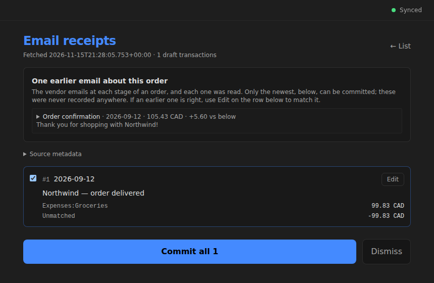

+++
title = "Receipts from email"
slug = "receipts-from-email"
date = 2026-11-16
draft = false
description = "omni-me reads receipts from email and groups every email about one order into a single review item. Nothing is booked until the user accepts it."

[taxonomies]
tags = ["rust", "llm", "ledger", "event-sourcing"]
+++

## What does this feature do?

omni-me can watch a mailbox and read every email that arrives. When an email records money
spent, such as a receipt, an order confirmation or a delivery notice, omni-me turns it into a
draft transaction and puts it in a review queue. Nothing is booked until the user accepts it.

A shop often sends several emails about one purchase. omni-me groups them into a single review
item using the order number the shop prints in the email. The newest email provides the draft,
and the earlier ones are shown above it so the user can see what was replaced.

## Why was it added now?

In September 2026, one supermarket order produced five emails. There was an order confirmation
for $105.43, an update that repeated $105.43, a reminder to add more items with no amount, a
delivery notice for $99.93, and a satisfaction survey. That was one purchase, whose amount
changed once along the way. The earlier importer treated each email as its own purchase, so
accepting everything it proposed would have booked about four times the money actually spent.

The earlier importer also only read mail from a list of known shops, which had to be extended
by hand for each new one. Tested on eight days of real mail, the list missed some receipts and
let through mail that was not one. Letting a model decide on every email, with no list, found
every receipt and was right about almost all of them. At personal email volumes, reading every
email this way costs about ten cents a month, so the list was removed.

## What's in scope (and what's not)?

**In:**
- Reading every email and deciding with a model whether it records money spent.
- Grouping emails about one order into one review item, using the order number printed in the
  email.
- Showing every earlier email a review item replaced.
- A later email about an order that was already accepted, such as a refund or a price change.
  It opens a new review item that can only add transactions, never change accepted ones.

**Not in:**
- Booking anything automatically. Anyone who knows the address can send an email, so every
  draft waits for the user, however confident the reading looks.
- Grouping emails that have no order number. Matching on shop, date and amount instead would
  sometimes merge two real purchases into one and lose a transaction without any sign. A
  duplicate left in the queue is visible and costs one tap to dismiss, so it is the safer
  mistake.

## How do we know it works?

The picture below is the real review screen with a made-up order. Two emails arrived for the
same order number. The delivery notice is the draft that can be accepted. The earlier order
confirmation, for a different amount, is listed above it and cannot be booked.

The order number is read by a model, so it is usually right but not certain. 
If the model misreads the order number there is the risk of a wrong grouping, 
which is why the screen always shows what was replaced. A wrong grouping then
looks like an unrelated email sitting above the draft, which the user can see, rather than a
transaction that silently disappeared.

[`core/src/events/auto_import_projection.rs:809`](https://github.com/RustWright/omni-me/blob/8caa3ca62596485b161918919d77473f0360b150/core/src/events/auto_import_projection.rs#L809) at `8caa3ca`
> `async fn two_messages_about_one_order_become_one_review_item() {`
>
> Two emails carrying the same order number end up as one item in the review queue, with the earlier one recorded as replaced.

[`core/src/events/auto_import_projection.rs:871`](https://github.com/RustWright/omni-me/blob/8caa3ca62596485b161918919d77473f0360b150/core/src/events/auto_import_projection.rs#L871) at `8caa3ca`
> `async fn a_message_about_a_committed_order_opens_its_own_review_item() {`
>
> An email about an order that was already accepted opens a new item instead of changing the accepted transactions.

Both tests run against a real database, and both passed with the rest of the core tests in the
automated test run on GitHub at `8caa3ca`
([the run](https://github.com/RustWright/omni-me/actions/runs/43741030947)).

## What's worth remembering or doing next?

- One transaction billed as several separate charges is not matched yet.
- Writing back to the mailbox, such as labelling or archiving processed emails, is deferred
  until the import has earned trust, not ruled out.
