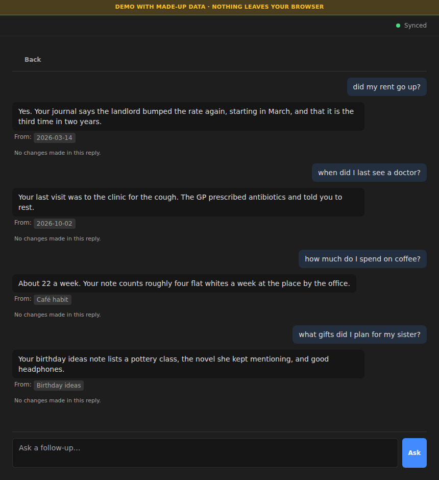

+++
title = "Search by meaning"
slug = "search-by-meaning"
date = 2026-11-15
draft = false
description = "omni-me's assistant finds records by meaning as well as by words. Treating the two as equals made results worse, so meaning sets the order."

[taxonomies]
tags = ["rust", "llm", "search"]
+++

## What does this feature do?

omni-me's assistant answers questions by searching the user's own records, and it searches
in two ways. The first way matches words, so it finds records that contain a word from the
question. The second way matches meaning, which uses a small embedding model that turns each record and each
question into a list of numbers, called a vector, and the records whose vectors are closest
to the question's vector count as the most related.

Matching by meaning finds records that matching by words cannot. A question about a rent
increase finds a journal entry saying "the landlord bumped the rate again", although the two
share no words.

The embedding model runs locally rather than at an outside provider, so finding records sends
nothing anywhere.

## Why was it added now?

Until September 2026, the assistant could only search by words, and a record had to contain
every word of the question to count as a match. A record written in different words was never
found, so an answer of "nothing found" was often wrong.

## What's in scope (and what's not)?

**In:**
- Word search and meaning search, combined so that meaning decides the order. Records that
  only the word search found are added at the end.
- A small embedding model that runs locally.
- Reranking, an optional third pass where a larger model reorders the results. It is off by
  default, for reasons measured below.

**Not in:**
- Comparing the two searches' scores. A word-search score depends on the whole collection of
  records, such as how many there are and how long they are, while a meaning score does not.
  The two numbers are not on the same scale, so the results are combined by position only.

## How do we know it works?

The picture below is the real Assistant page with made-up records. The answer sentences were
written for the picture. Each cited record is the one the embedding model ranked first for
that question, out of twelve made-up records.

None of the four cited records shares a word with its question. Each one also beat a decoy
that does share words:

| Question | Ranked first (score) | Best record sharing a word (score) |
|---|---|---|
| did my rent go up? | "The landlord bumped the rate again…" (0.685) | "Went up the hill…" (0.545) |
| when did I last see a doctor? | "Clinic visit for the cough…" (0.642) | "Last day of the sprint…" (0.488) |
| how much do I spend on coffee? | "Café habit: about four flat whites…" (0.526) | "Coffee table arrived today…" (0.502) |
| what gifts did I plan for my sister? | "Birthday ideas for my little sibling…" (0.652) | "Sister called about the plan…" (0.631) |

The scores are cosine similarity, where 1 means the same meaning. The coffee and sister
questions are close, and they are left in for that reason. The table can be reproduced with
[`scripts/search-demo-rank.py`](https://github.com/RustWright/omni-me/blob/3ba56faff161c87b20592b41aa8fb3b1196552fc/scripts/search-demo-rank.py).

A larger set of test questions gives the same result. Word search alone found the right
record for half of them. With meaning search added, it found the right record every time and
ranked it first three times in four.

The first design combined the two searches as equals, using a standard method called
reciprocal rank fusion. A record's score was the sum of `1 / (60 + rank)` over both lists.
Under that rule, a record that appears in both lists beats a record ranked first in only one.
Word search matches any record that shares any word with the question, so appearing in both
lists was easy and meant little. Measured on the test questions, combining them as equals
dropped the share of right records ranked first from 75% to 56%. So meaning search now decides
the order, and word search only adds what it missed.

[`core/src/assistant/fusion.rs:28`](https://github.com/RustWright/omni-me/blob/3ba56faff161c87b20592b41aa8fb3b1196552fc/core/src/assistant/fusion.rs#L28) at `3ba56fa`
> `pub fn prefer(primary: &[RecordKey], secondary: &[RecordKey]) -> Vec<(RecordKey, f64)> {`
>
> The first list keeps its order, and the second list only adds records the first did not have. Nothing is reordered and nothing is lost.

Reranking was measured the same way, with four models. Three of the four made the results
worse than not reranking at all. The one that helped raised the right records ranked first
from 75% to 88%, but that is two questions, which is too few to call proven. Reranking
therefore stays off.

## What's worth remembering or doing next?

- Search has only been measured on notes and journal entries. Archived documents are next.
- Word search has no stemming, so "rental" does not match "rent".
