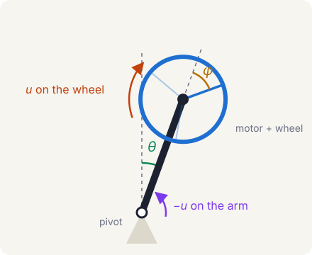

+++
title = "Reaction-wheel pendulum model"
description = "A non-linear model of a reaction-wheel pendulum, checked against its own linearization, with a demo where you try to balance it yourself."
slug = "pendulum-model"
date = 2026-10-25
draft = false

[taxonomies]
tags = ["control-systems", "simulation", "python", "robotics", "adaptive-control"]

[extra]
math = true
+++

## What does this feature do?
This is a non-linear model and a linear model of a reaction-wheel pendulum. It has 3 state variables: the arm angle $\theta$, its rate $\dot\theta$, and the wheel's speed relative to the arm, $\dot\varphi$. Its plant input, $u$, is the motor torque on the reaction wheel (diagram below).

The simulation runs in Python, stepping with RK4 at 1 ms. The model can be linearized about either rest position, upright or hanging.

## Why was it added now?
I'm currently taking [a course on adaptive control](@/posts/resources/control-theory-refresher.md). While a lot of the concepts are fascinating, most experiments in class are purely simulation.

I started this project to understand those concepts more deeply by testing them on physical hardware. Before I design and test a controller, I need a model to base the design on.

The hardware was still shipping, so the model gave me something to build in the meantime.

Any LQR-based controller is designed against the linear model, not the non-linear one, so the linearization has to be justified first. I compared the two about both fixed points, upright and hanging.

## What's in scope (and what's not)?
Not in:
- Friction is ignored at both rotating joints. Ball bearings should keep it small, and system identification will measure how small.

## How do we know it works?

The demo below runs the same model in your browser. It is a JavaScript port of the Python model, so it checks the model rather than the Python file itself. Under "What the linear model predicts", press "Test the top" and "Test the bottom". Each runs the full non-linear simulation and compares it with what the linear model's eigenvalues predict. Near upright, a small tilt grows at 8.767 per second against a predicted 8.770, 0.04% apart. Near the bottom, the swing period is 0.7165 s, matching the prediction to 0.01%.

The model's functions also pass 11 automated tests. They cover both rest positions, the reaction to a pure torque, the wheel's speed having no effect on the arm, energy staying constant over a frictionless swing, and the linear model checked against finite differences of the non-linear one.

{{ demo(name="reaction-wheel/pendulum", wide=true, height=780, playground=true, caption="The model running in your browser. Press the two test buttons to check the linear model's predictions, drag the arm to swing it, or switch to Balance it and try to keep it upright yourself.", playground_caption="Be the controller. Spin the wheel to keep the pendulum upright, with time slowed to an eighth. Then try Free swing, switch solvers, or test the linear model's predictions.") }}

## What's worth remembering or doing next?
Once the physical prototype is built, the model's parameters will be updated with measured values.
